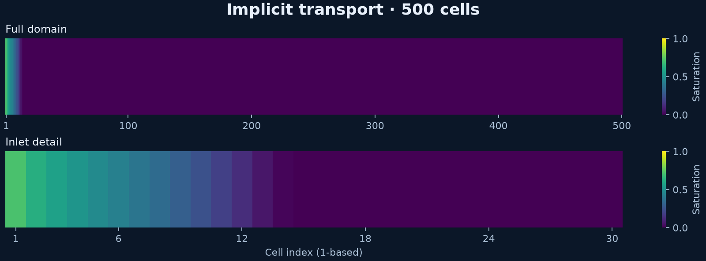

# Nonlinear systems

The solver seeks a root of a square system $F:\mathbb{R}^n\to\mathbb{R}^n$. At the current iterate $x_k$, it uses a Broyden matrix $B_k$ to model the residual by $F_k+B_kp$, where $F_k=F(x_k)$.

## Step and acceptance

The solver obtains a minimum-norm least-squares direction and scales it to fit the radius $\Delta_k$.

$$
d_k=\operatorname*{arg\,min}_{d}\|F_k+B_kd\|_2,\qquad
p_k=d_k\min(1,\Delta_k/\|d_k\|_2).
$$

When the direction is zero or the iterate cannot change at floating-point precision, the solver reports stagnation. For a nonzero trial step, it compares the actual and predicted reductions in squared residual norm.

$$
r_k=
\frac{\|F_k\|_2^2-\|F(x_k+p_k)\|_2^2}
{\|F_k\|_2^2-\|F_k+B_kp_k\|_2^2}.
$$

A trial is accepted when the predicted reduction is positive, the trial residual is finite, and $r_k\ge\rho$. Rejection shrinks the radius by $c$. Accepted steps with $r_k<0.25$ also shrink the radius. A successful near-boundary step with $r_k>0.75$ expands it by $1/c$.

## Broyden update

For an accepted step, $s_k=x_{k+1}-x_k$ and $y_k=F(x_{k+1})-F(x_k)$. The rank-one update enforces the secant condition $B_{k+1}s_k=y_k$.

$$
B_{k+1}=B_k+\frac{(y_k-B_ks_k)s_k^\top}{s_k^\top s_k}.
$$

Use an analytic Jacobian or start with scaled centered differences. For coordinate $j$, the default uses $h_j=10^{-5}\max(1,|x_j|)$ and the difference quotient $(F(x+h_je_j)-F(x-h_je_j))/(2h_j)$.

## Example and diagnostics

The [circle and line example](../README.md#quick-start) solves $F(x,y)=(x^2+y^2-1,\ x-y)$. `solve_nonlinear` reports the final iterate, accepted and attempted steps, residual history, and a stopping reason. Check `result.converged` and the last residual. `max_iter` counts rejected trials as well as accepted ones. The compatibility function `broyden_trust_region(func, grad, x0, epsilon, rho, c, max_iter)` returns `(x, accepted_steps)`.

The radius starts at $c\max(1,\|x_0\|_2)$. This dense implementation clips a least-squares direction to the radius. Convergence can depend on the starting point, scaling, and Jacobian quality. A small residual can coexist with a large error in $x$ near an ill-conditioned root.

## Implicit transport

The original heatmap uses an implicit upwind residual with unit inlet saturation. For cell $i$, it solves

$$
R_i(S)=S_i+N\Delta t\big[f(S_i)-f(S_{i-1})\big]=0,\qquad S_0=1.
$$

Here $f(s)=s^{2+e}/[s^{2+e}+M(1-s)^{2+e}]$ on $[0,1]$. The demo uses the analytic lower bidiagonal Jacobian and retains the original 500-cell default.

## Reference

C. G. Broyden, *A Class of Methods for Solving Nonlinear Simultaneous Equations*, Mathematics of Computation 19 (1965), 577–593.
