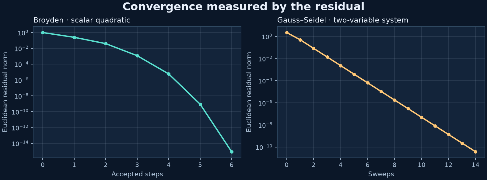

# Numerical Mathematics

Python implementations of Broyden’s method, Gauss–Seidel iteration, natural cubic splines, and Bairstow’s method.



## Quick start

Python 3.10+

```sh
python -m pip install -r requirements.txt
python -m unittest discover -s tests -v
```

## Methods and examples

- [Nonlinear systems](docs/nonlinear-systems.md)
- [Numerical utilities](docs/numerical-utilities.md)
- [Interpolation plot](docs/figures/interpolation.png)
- [Transport example](Nonlinear%20systems/Broyden-TrustRegion.py)
- [Source](numerical_math) · [Examples](examples) · [Tests](tests)
