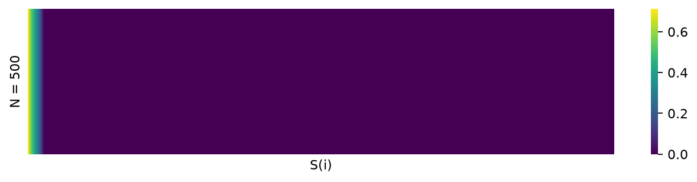

# Broyden trust-region methods

Amir Fardiyan’s [original solver at revision 566271f](https://github.com/Amir-Fardiyan/Numerical-Mathematics/blob/566271fe4a9f8d1863c373ffa2e5702cbd40c6f4/Nonlinear%20systems/Broyden-TrustRegion.py) used a prescribed acceptance denominator and a residual-based radius reset. The [review branch solver](../numerical_math/nonlinear.py) retains the root equation, radial step scaling, and Broyden rank-one update, and changes several rules that determine its iterates. The [mathematical audit](method-audit.md) records both algorithms and the reasons for the changes. The algorithm below describes the review branch. The legacy function name currently delegates to that implementation.

## Problem and initialization

Given a real vector function $F$ of $n$ real variables, find $`x_\star`$ such that

```math
F:\mathbb{R}^{n}\to\mathbb{R}^{n},\qquad F(x_\star)=0.
```

The solver starts with $`x=x_0`$, $f=F(x)$, and residual history $`H=[\Vert f\Vert _2]`$. It returns immediately if the initial point satisfies the tolerance or the trial budget is zero. Otherwise, $B$ is the matrix returned by the supplied Jacobian callback at $`x_0`$, or a centered finite-difference approximation when the callback is omitted. It is initialized once. For coordinate $j$, with $`e_j`$ the $j$th coordinate vector, the nominal offset is

```math
h_j=\delta_{\mathrm{FD}}\max(1,|x_j|),\qquad
x_j^+=x+h_j e_j,\qquad x_j^-=x-h_j e_j.
```

The code divides the residual difference by the actual floating-point span $`[x_j^+]_j-[x_j^-]_j`$. In exact arithmetic this span is $`2h_j`$.

```math
B_{:,j}=\frac{F(x_j^+)-F(x_j^-)}{[x_j^+]_j-[x_j^-]_j}.
```

The initial radius is $`\Delta=c\max(1,\Vert x_0\Vert _2)`$.

For a sufficiently smooth residual, the centered difference has truncation error of order $`h_j^2`$ in exact arithmetic. In floating point, cancellation in the residual difference can dominate for small offsets. Using the realized coordinate span accounts for rounding in the denominator, while asymmetry of the rounded perturbations and evaluation error can remain.

## Minimum-norm direction

In exact arithmetic, the minimum-norm solution of the unconstrained least-squares problem for the affine residual $f+Bd$ is $d=-B^\dagger f$, where $B^\dagger$ is the Moore–Penrose pseudoinverse. Let $B=U\Sigma V^\top$ have singular values $`\sigma_i`$ and left and right singular vectors $`u_i`$ and $`v_i`$. The numerical rank cutoff gives the retained set $`I_\tau`$, with threshold $`\tau=n\varepsilon_{\mathrm{mach}}\sigma_{\max}`$ for the square system. For the truncated matrix $`B_\tau`$, the direction is represented mathematically by

```math
B_\tau=\sum_{i\in I_\tau}\sigma_i u_i v_i^\top,\qquad
d=-B_\tau^\dagger f=-\sum_{i\in I_\tau}\frac{u_i^\top f}{\sigma_i}\,v_i.
```

In retained coordinates the least-squares problem gives $`v_i^\top d=-u_i^\top f/\sigma_i`$. Components along discarded right singular vectors cannot improve the truncated model residual. Setting them to zero gives the minimum norm. An empty retained set yields $d=0$. When the model has full rank and all singular values are retained, the exact direction solves $Bd=-f$. The source calls `numpy.linalg.lstsq(B, -f, rcond=None)` and never forms the pseudoinverse explicitly. The cutoff applies to the direction solve. Predicted reduction and the Broyden update use the stored matrix $B$. [NumPy least-squares reference](https://numpy.org/doc/stable/reference/generated/numpy.linalg.lstsq.html)

## Radial step truncation

For $d\ne 0$ the trial step is

```math
p=d\min\!\left(1,\frac{\Delta}{\Vert d\Vert_2}\right).
```

When $d=0$, the trial step is zero.

Radial truncation projects $d$ onto the Euclidean ball along its ray. The exact trust-region least-squares subproblem instead minimizes $`\frac{1}{2}\Vert f+Bp\Vert_2^2`$ subject to $`\Vert p\Vert_2\leq\Delta`$. For $`\Delta>0`$, its optimality conditions require a multiplier $\lambda\geq0$ such that

```math
(B^\top B+\lambda I)p=-B^\top f,\qquad
\Vert p\Vert_2\leq\Delta,\qquad
\lambda(\Vert p\Vert_2^2-\Delta^2)=0.
```

The radial step need not satisfy these conditions. The [audit](method-audit.md#radial-clipping-and-the-constrained-model) gives a two-dimensional counterexample.

## Actual and predicted reductions

Form the floating-point trial point $z=x+p$. If it equals $x$ componentwise, report stagnation. Otherwise use the realized step $s=z-x$. Let $t=F(z)$, $y=t-f$, and $m=f+Bs$ be the affine prediction of $t$. Define the merit function $`\Phi(x)=\Vert F(x)\Vert_2^2`$. Subtracting the trial merit value from the current value and expanding $t=f+y$ gives

```math
A=\Phi(x)-\Phi(z)
=\Vert f\Vert_2^2-\Vert t\Vert_2^2
=-2f^\top y-y^\top y
=(f-t)^\top(f+t).
```

Replacing $t$ by $m$ gives the model reduction

```math
P=\Vert f\Vert_2^2-\Vert f+Bs\Vert_2^2
=-2f^\top Bs-s^\top B^\top Bs
=(f-m)^\top(f+m).
```

The source evaluates the factored forms, avoiding direct subtraction of two accumulated squared norms. Near cancellation can still occur, including when forming $m$ and $f-m$.

## Acceptance and radius adjustment

After checking the trial residual’s shape, the code rejects a nonfinite trial residual or $P\leq0$. Otherwise it computes $r=A/P$. It rejects a nonfinite $r$ or $`r<\rho`$ and accepts the remaining trials. In exact arithmetic, acceptance implies $`A\geq\rho P>0`$ and therefore a strict decrease in the residual norm. This is a per-step property and supplies no convergence or rate guarantee.

The following piecewise rule uses the radius before the trial and the length of the direction before clipping.

| Trial outcome | Next radius |
| --- | --- |
| Rejected | $c\Delta$ |
| Accepted with $`r<0.25`$ | $c\Delta$ |
| Accepted with $`r>0.75`$ and $`\Vert d\Vert _2\geq 0.9\Delta`$ | $\Delta/c$ |
| Other accepted trial | $\Delta$ |

The expansion threshold on the ratio is strict, and equality at $`\Vert d\Vert_2=0.9\Delta`$ qualifies for expansion when $`r>0.75`$. An accepted ratio equal to $0.25$ or $0.75$ retains the radius. Stagnation exits before the acceptance and radius logic. Rejection consumes one trial and leaves $x$, $f$, $B$, and the accepted residual history untouched.

## Good Broyden update

For an accepted displacement $s$ and residual difference $y=t-f$, the good Broyden Jacobian update is

```math
B^+=B+\frac{(y-Bs)s^\top}{s^\top s}.
```

The secant condition follows by multiplying by $s$:

```math
B^+s=Bs+(y-Bs)\frac{s^\top s}{s^\top s}=y.
```

Among updates satisfying the secant condition, this is the one of least Frobenius norm. Each row correction must have a prescribed dot product with $s$, and its smallest Euclidean norm is attained by making that row parallel to $s^\top$. The code computes the outer product of $`(y-Bs)/\Vert s\Vert_2`$ and $`s/\Vert s\Vert_2`$. It then sets $x=z$, $f=t$, and appends $`\Vert f\Vert_2`$ to the history.

## Complete pseudocode

```text
Validate inputs. Copy x0 and evaluate its residual f.
H ← [norm2(f)]
status ← converged if H[0] ≤ epsilon, otherwise trial_limit
trials ← 0
If status is converged or max_iter = 0:
    return x, accepted_steps = 0, trials, H, status

B ← supplied Jacobian at x, or the following centered differences:
    For j = 1 through n:
        h ← 10⁻⁵ × max(1, abs(x[j]))
        x_plus ← x + h × e_j
        x_minus ← x - h × e_j
        span ← x_plus[j] - x_minus[j]
        If span is zero or nonfinite: raise an error
        Evaluate F at both points and validate both residual vectors
        B[:, j] ← (F(x_plus) - F(x_minus)) / span, using those evaluations
Validate B. Set radius ← c × max(1, norm2(x)).

For trials = 1 through max_iter:
    d ← -pseudoinverse(B_tau) × f, evaluated by the rank-aware least-squares solve
    length ← norm2(d)
    p ← d if length ≤ radius, otherwise (radius / length) × d
    z ← x + p
    If z equals x componentwise:
        status ← stagnated
        exit loop

    s ← z - x
    m ← f + B s
    P ← dot(f - m, f + m)
    t ← F(z)
    If t has the wrong shape: raise an error
    If t is nonfinite or P ≤ 0:
        radius ← c × radius
        continue
    A ← dot(f - t, f + t)
    r ← A / P
    If r is nonfinite or r < rho:
        radius ← c × radius
        continue

    If r < 0.25: radius ← c × radius
    Else if r > 0.75 and length ≥ 0.9 × radius: radius ← radius / c
    B ← B + outer((t - f - B s) / norm2(s), s / norm2(s))
    x ← z
    f ← t
    Append norm2(f) to H
    If the latest entry of H ≤ epsilon:
        status ← converged
        exit loop

Return x, accepted_steps = len(H) - 1, trials, H, status.
```

## Parameters

| Argument | Default | Meaning in the review branch |
| --- | --- | --- |
| `func` | Required | Residual function. Its output must be a real vector of the same shape as `x0`. |
| `x0` | Required | Finite, nonempty real starting vector. |
| `grad` | `None` in `solve_nonlinear` | Initial Jacobian or Jacobian approximation. The legacy wrapper requires this argument. |
| `epsilon` | `1e-12` | Positive, finite absolute tolerance on the Euclidean residual norm. |
| `rho` | `0.1` | Minimum acceptable actual-to-predicted reduction ratio, strictly between zero and one. |
| `c` | `0.5` | Initial radius factor, contraction multiplier, and reciprocal expansion multiplier. Strictly between zero and one. |
| `max_iter` | `100` | Nonnegative integer budget for trial loop entries. A rejected trial or the final stagnation check consumes one entry. |
| `delta` in `calculate_jacobian` | `1e-5` | Positive, finite base step $`\delta_{\mathrm{FD}}`$. It is independent of the trust-region radius and transport constants. |

The radius thresholds $0.25$, $0.75$, and $0.9$ are constants in the implementation. To use a different finite-difference base step, supply a Jacobian callback that calls `calculate_jacobian` with that step.

## Convergence test and termination states

| Status | Condition |
| --- | --- |
| `converged` | The initial residual or the latest accepted residual satisfies $`\Vert F(x)\Vert_2\leq\epsilon`$. |
| `trial_limit` | The budget is zero with an initial residual above tolerance, or the trial loop exhausts the budget without either other status. |
| `stagnated` | The computed candidate equals the current iterate componentwise before the candidate residual is evaluated. |

`solve_nonlinear` returns a `BroydenResult` with the final iterate, the counts of accepted steps and entered trials, the accepted residual history including the initial norm, and the status. The final stagnation check counts as an entered trial. The legacy wrapper returns `(x, accepted_steps)`. Input validation and least-squares factorization errors can raise exceptions outside the result status protocol.

## Numerical limitations and computational cost

- The solver uses an absolute residual tolerance in the units of $F$. A small residual can coexist with a large error in $x$ for an ill-conditioned root. Starting point, variable units, and residual scaling can influence the computed steps and stopping test.
- Numerical rank truncation can suppress directions that would require division by small singular values. A large residual can remain, and a zero direction can trigger stagnation. Repeated rejection only contracts the radius. The solver has no Jacobian refresh, fallback direction, or independent small-step tolerance.
- Nonfinite trial residuals and ratios are rejected. Extreme scales can still cause overflow, underflow, or cancellation in norms, reduction estimates, and the rank-one update. Centered differences require valid residual evaluations on both sides of the starting point.
- Let $n$ be the dimension, $K$ the number of entered trials, and $`C_F`$ the cost of one residual evaluation. Finite-difference initialization adds $2n$ residual evaluations and $\mathcal{O}(n^2)$ vector and matrix work. With a Jacobian callback, initialization instead incurs the callback cost and $\mathcal{O}(n^2)$ copying and validation.
- Each entered trial recomputes a dense least-squares solution, including when the preceding trial was rejected. Its dense linear algebra costs $\mathcal{O}(n^3)$ per trial. An accepted iteration also has a $\mathcal{O}(n^2)$ matrix–vector and rank-one update cost. Each trial that moves the point in floating point evaluates one candidate residual, so the trial phase costs at most $`\mathcal{O}(K(n^3+C_F))`$. Working storage is $\mathcal{O}(n^2+K)$ including dense factorization workspace and residual history, excluding user callback storage.

The acceptance inequality shows decrease on accepted steps in exact arithmetic. It does not establish that the residual tends to zero or that this implementation has a particular local rate.

## Examples

The circle–line example solves $F(x,y)=(x^2+y^2-1,\ x-y)$ from $(0.8,0.3)$.

```python
from numerical_math import solve_nonlinear


def residual(x):
    return [x @ x - 1, x[0] - x[1]]


result = solve_nonlinear(residual, [0.8, 0.3])
print(result.x, result.status, result.residual_norms[-1])
```

The [transport demo](../examples/transport.py) uses a unit inlet $`S_0=1`$ with the unknowns indexed from $1$ through $N$. The vector contains these $N$ unknowns only. With $q=2+e$ and the flux $`\phi(v)=v^q/[v^q+M(1-v)^q]`$ for $v$ in $`[0,1]`$, the review-branch residual is

```math
v_i=\min(1,\max(0,S_i)),\qquad
R_i(S)=S_i+N\Delta t\,[\phi(v_i)-\phi(v_{i-1})],
\quad i=1,\ldots,N,\quad v_0=1.
```

The review-branch demo uses an analytic lower bidiagonal initial Jacobian. Its diagonal entries are $`1+N\Delta t\,g(S_i)`$ and its subdiagonal entries are $`-N\Delta t\,g(S_{i-1})`$ for $i\geq2$. Here $g$ is the derivative of the clipped flux. For $`0<s<1`$,

```math
g(s)=\frac{qM[s(1-s)]^{q-1}}
{[s^q+M(1-s)^q]^2}.
```

The implementation gives zero outside that interval, including the endpoints for this value of $q$. The demo defaults to $N=500$, $\Delta t=0.01$, $e=0.1167$, $M=1.1177$, and all initial unknowns set to $10^{-8}$. The original demo instead initialized its Jacobian by fixed centered differences and used a lower clipping bound of $10^{-50}$.



## Changes from the historical implementation

The [historical source and comparison table](method-audit.md#comparison) document each change and its rationale. In revision `566271f`, the solver initialized $B$ from the required callback and the transport demo used fixed centered differences. The historical search direction solved $Bd=-f$ with unpivoted LU. Its acceptance denominator was $-f^\top p-\frac{1}{2}p^\top Bp$. It used any nonzero denominator in the ratio, initialized and reset its radius after acceptance to $`c\Vert F(x)\Vert_2`$, and capped accepted steps only.

The review branch introduces coordinate-scaled differences and rank-aware least squares, uses the realized displacement in the reductions and secant update, changes the reduction model and acceptance guards, adopts the state-scaled initial radius and ratio-based accepted-step radius rule, and caps trial entries. It tests initial and final accepted residuals, detects an unchanged iterate, and uses an analytic initial Jacobian and a zero lower flux clipping bound in the transport demo. The original nonlinear target, radial clipping rule, actual-reduction identity, rejection contraction, residual tolerance test, and good Broyden update remain identifiable in both versions. The audit records the differences in their finite-precision evaluation and includes reproducible cases where the iterations diverge.

## References

- C. G. Broyden. *A Class of Methods for Solving Nonlinear Simultaneous Equations*. Mathematics of Computation 19(92), 577–593, 1965. [Original quasi-Newton method](https://doi.org/10.1090/S0025-5718-1965-0198670-6)
- R. Penrose. *A Generalized Inverse for Matrices*. Proceedings of the Cambridge Philosophical Society 51(3), 406–413, 1955. [Generalized inverse](https://doi.org/10.1017/S0305004100030401)
- J. J. Moré and D. C. Sorensen. *Computing a Trust Region Step*. SIAM Journal on Scientific and Statistical Computing 4(3), 553–572, 1983. [Constrained trust-region subproblem](https://doi.org/10.1137/0904038)
