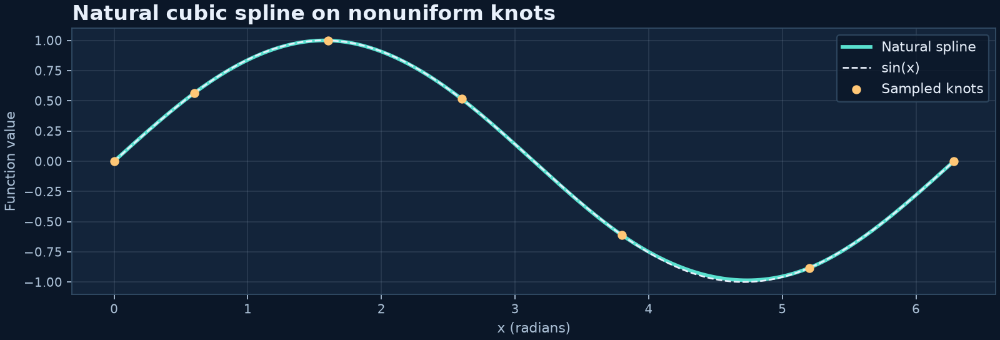

# Numerical utilities

## Gauss–Seidel

For $Ax=b$, each sweep uses the latest updates below the diagonal and the previous values above it.

$$
x_i^{(k+1)}=
\frac{b_i-\sum_{j<i}a_{ij}x_j^{(k+1)}-\sum_{j>i}a_{ij}x_j^{(k)}}{a_{ii}}.
$$

Strict row diagonal dominance and symmetric positive definiteness are sufficient conditions for convergence. Start at zero and stop when the infinity norm of the component update falls below `max_err` or the sweep limit is reached. Check the residual independently.

```python
import numpy as np
from numerical_math import gauss_sidel

A = np.array([[4, 1], [2, 3]])
b = np.array([1, 2])
x = gauss_sidel(A, b, max_it=100, max_err=1e-12)
print(x, np.linalg.norm(A @ x - b))
```

## Natural cubic spline

On each interval, with offset $t=x-x_i$, the interpolant is $a_it^3+b_it^2+c_it+d_i$. Its second derivatives $M_i$ satisfy a tridiagonal system with natural boundary conditions $M_0=M_{n-1}=0$. For interior knots, with $h_i=x_{i+1}-x_i$,

$$
h_{i-1}M_{i-1}+2(h_{i-1}+h_i)M_i+h_iM_{i+1}
=6\left[\frac{y_{i+1}-y_i}{h_i}-\frac{y_i-y_{i-1}}{h_{i-1}}\right].
$$

`cubic_spline(x, y)` sorts both lists in place and solves this system by tridiagonal elimination. `cubic_spline_interpolate` returns the value and first two derivatives, or `None` outside the knot range.



## Bairstow’s method

Given real coefficients in descending degree order, Bairstow iteration adjusts $r,s$ to make the synthetic-division remainders $R_1,R_0$ vanish.

$$
P(x)=(x^2-rx-s)Q(x)+R_1(x-r)+R_0.
$$

The solver normalizes coefficients before each deflation and uses a companion-matrix solve when a correction is singular, the iteration budget is exhausted, or the final roots fail a coefficient-scaled residual check. Repeated roots and polynomials with widely separated scales can be ill-conditioned. Root ordering is unspecified.

```python
import numpy as np
from numerical_math import bairstow

coefficients = [1, -2, 1, -2]  # (x - 2)(x² + 1)
roots = bairstow(coefficients, max_it=100, err=1e-12)
print(roots, np.abs(np.polyval(coefficients, roots)))
```
